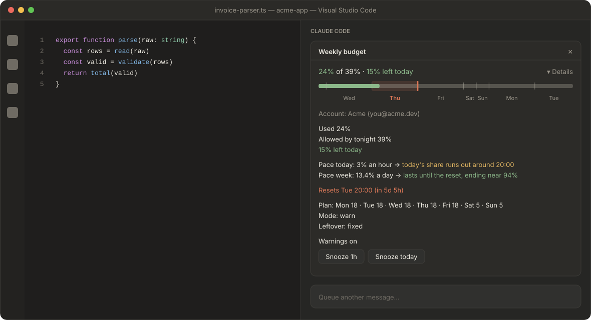
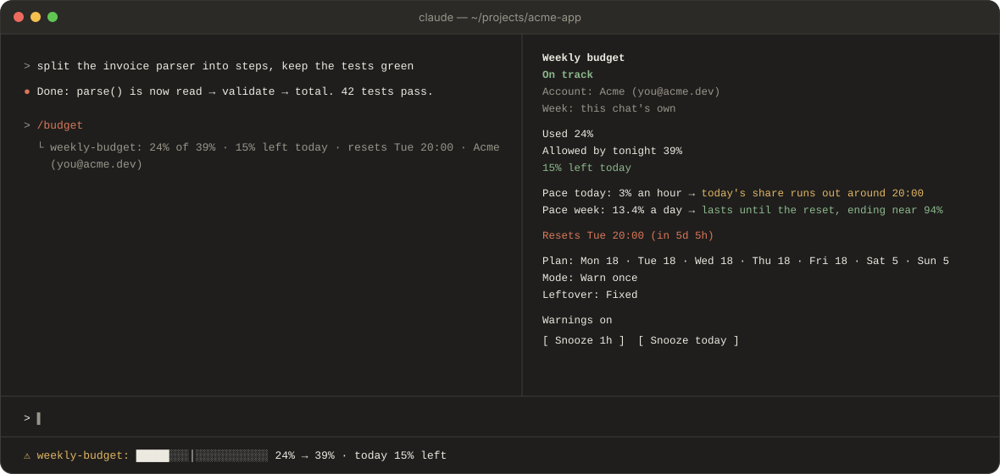
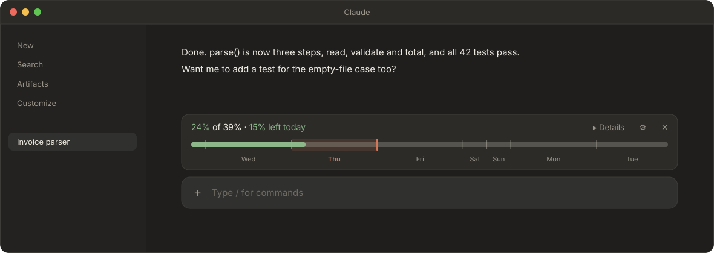
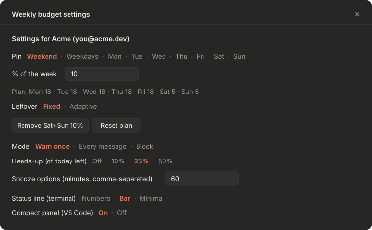
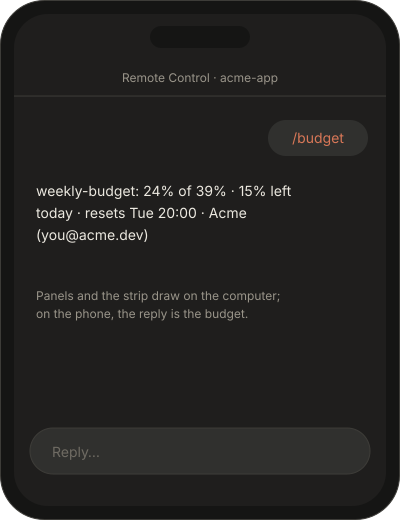

<p align="center">
  
</p>

<h1 align="center">weekly-budget</h1>

<p align="center">
  <b>Plan your weekly Claude limit like a budget, so Friday-you isn't left with crumbs.</b>
</p>

<p align="center">
  <a href="https://github.com/Fafafa12/claude-weekly-budget/actions/workflows/test.yml"></a>
  
  
  
</p>

<p align="center">
  <a href="#quick-start">Quick start</a> ·
  <a href="#a-tour">A tour</a> ·
  <a href="#how-the-plan-works">How the plan works</a> ·
  <a href="#settings">Settings</a> ·
  <a href="#whats-been-built">What's been built</a> ·
  <a href="#where-were-stuck-for-now">Where we're stuck</a>
</p>

---

Your Claude subscription has a weekly usage limit, and the limit doesn't care that it's only Tuesday. **weekly-budget** does. You decide how the week is shared out across the days, for example a light 10% for the whole weekend. It then shows where you stand against that plan in the terminal, in VS Code and in the Claude desktop app. It warns you when you get ahead of yourself, and if you like, it holds your next message back until you decide you really mean it.

<p align="center">
  
</p>

## Why

Claude's weekly limit is a shared fridge. Monday-you is enthusiastic and eats everything. Friday-you opens the door to an empty shelf and a note that says *resets Tue 20:00*. weekly-budget labels the shelves:

- **A plan for the week**, day by day, with the days you care about pinned: weekends light, crunch days heavy.
- **Where you stand at a glance:** used, allowed by tonight, and what's left for today.
- **Where you're heading:** at your pace, when today's share runs out and whether the week lasts.
- **Warnings that know when to stop:** once, on every message, or a polite block, plus snooze when you know what you're doing.
- **One budget per account**, if you have a personal and a work login.

## Quick start

1. **Install it**, in any Claude Code session:

   ```
   /plugin install weekly-budget --marketplace Fafafa12/claude-weekly-budget
   ```

2. **Make a plan.** Run `/budget-config`, pick **Weekend**, type `10`. The weekdays now share the other 90%, 18% each.

3. **Check in whenever you like.** Run `/budget`:

   ```
   24% of 39% · 15% left today · resets Tue 20:00 · Acme (you@acme.dev)
   ```

   That reads: you've used 24% of the week, the plan allows 39% by tonight, so 15% is left for today.

That's it. The budget is always visible: in the terminal's status line, in VS Code's panel and in the desktop app's strip.

## A tour

The pictures use one made-up week: Thursday 15:00, the weekend pinned at 10%, 24% used. They are drawn from the plugin's own code (see [Development](#development)), so what you see is what it shows.

### Terminal

<p align="center">
  
</p>

The **status line** under the prompt is always there. Its bar has a mark (│) for what the plan allows by tonight, and ▓ for anything you used past it, so "over" reads even without colour. `/budget` replies with the numbers and opens the **details** beside the chat; `/budget-config` opens the settings with the keyboard on them.

### VS Code

One panel sits above the chat box and opens by itself when a chat starts. Its first line is the summary, with what you used and today's balance coloured by where you stand. Under it is the week as one bar: each day as wide as its share of the plan, today highlighted, a marker at what's allowed by tonight. **▸ Details** unfolds the rest (the picture above has it open).

### Claude desktop app

<p align="center">
  
</p>

A thin strip sits just above the message box. **▸ Details** opens the details beside the conversation, **⚙** opens the settings, and **✕** hides the strip for that chat; `/budget` brings it back.

### Settings

<p align="center">
  
</p>

Every setting is a row of choices; the chosen one is in Claude orange. Each account has its own, and the header says whose they are.

### On your phone

<p align="center">
  
</p>

Driving a session from the Claude app with Remote Control? Panels and the strip draw on the computer, but replies reach the phone, so `/budget` answers in words.

## How the plan works

- **The week is Claude's own week**, from one limit reset to the next, not Monday to Sunday. Days are cut at midnight in your local time zone.
- **You pin days or groups of days to a share of the week.** For example, the weekend (Saturday and Sunday together) gets 10%. Single days and Monday to Friday can be pinned too.
- **The days you don't pin share the rest evenly.** With no pins, every day gets one seventh. Pinned shares can't add up to more than 100%. If they add up to exactly 100%, any unpinned days get nothing.
- **The allowance adds up through the week.** "Allowed by tonight" is what the plan allows up to the end of today. What you don't use, or use past your share, is handled by the **Leftover** setting: by default it lands on the next day; set to Adaptive, it is spread over the rest of the week (see [Leftover: Fixed or Adaptive](#leftover-fixed-or-adaptive)).
- **The days where the week starts and ends** are split by the hours that fall inside the week, so the shares still add up to 100%.

### A week, worked through

The weekend is pinned at 10%, so Saturday and Sunday get 5% each and the five weekdays share the other 90%, 18% each. The week resets on Tuesday at 20:00.

| Thursday, 15:00 | | Why |
| --- | --- | --- |
| Used | **24%** | What Claude reports for the week. |
| Allowed by tonight | **39%** | Tuesday's last 4 hours (3%) + Wednesday (18%) + Thursday (18%). |
| Left today | **15%** | 39% − 24%. |
| Pace today | 3% an hour → runs out around **20:00** | 15% left at 3% an hour is 5 hours. |
| Pace week | 13.4% a day → ends near **94%** | 24% in the 1 day 19 hours since Tuesday 20:00, carried to the reset. |

If you stop for the day here, the 15% you didn't use moves on: with **Fixed** leftover, Friday gets 18% + 15% = 33%; with **Adaptive**, it is spread over Friday, Monday and Tuesday.

## Where your pace leads

The details have two lines under the numbers:

```
Pace today: 3% an hour → today's share runs out around 20:00
Pace week: 13.4% a day → lasts until the reset, ending near 94%
```

- **Pace today** is your speed over the last 2 hours, turned into the time today's share runs out (to the quarter hour). It says **lasts the day** when the share outlives midnight, **no use in the last 2 hours** when you've been away, and **not enough readings yet** until it has half an hour of them. When you're already over, the state says it all and this line steps aside.
- **Pace week** is your average per day so far this week, carried to the reset: the moment it would reach the limit (amber), or where the week would end (green). It waits for the first 12 hours of the week before guessing.

It only informs: no new warnings, nothing extra in the status line or the strip. Honest caveat: the week's average doesn't know that your weekend is pinned light, so it can sound gloomier than your plan really is.

## Commands

| Command | What it does |
| --- | --- |
| `/budget` | Replies with where the week stands, in one line: `24% of 39% · 15% left today · resets Tue 20:00` (fetching a fresh figure first), and the account's name once it's known. It also opens the details in the terminal, the budget panel in VS Code (even if you closed it), and brings back the strip in the desktop app if you hid it. On your phone, with Remote Control, the reply is what shows. |
| `/budget snooze 30m`, `1h`, `today` or `off` | Snoozes warnings for that long (any number of minutes or hours works), until the end of today, or ends the snooze. |
| `/budget-config` | Opens the settings: the plan, the leftover, the mode, the heads-up, the snooze durations, the status line style and the VS Code panel's view. See [Settings](#settings). |

## Settings

Run `/budget-config` to change them. **Each account has its own settings**, and the panel says which account it is changing: by its name ("Settings for Acme (you@acme.dev)"), or, before a chat on it has asked Anthropic, by when its week resets ("…the account whose week resets Tue 20:00"). A change applies at once, in every open chat on that account. An account seen for the first time starts with a copy of the settings last used on the same app. Snooze is one for all. A value the plan's checks refuse, such as shares adding up to more than 100%, shows in red and changes nothing.

- **In VS Code and the desktop app**, click a choice.
- **In the terminal**, the settings open with the keyboard on them: Tab or the arrow keys move, Enter chooses, Esc goes back to the prompt. To come back to the panel later, press `ctrl+x tab`.

| Setting | Choices | Default | What it does |
| --- | --- | --- | --- |
| **Pin** and **% of the week** | Weekend, Weekdays, or one day; then a percent | no pins | Gives those days that share of the week, split evenly between them. Pinning a day that is already in a group replaces that group. |
| **Remove …** / **Reset plan** | buttons | | Remove one pin, or all of them. |
| **Leftover** | Fixed · Adaptive | Fixed | What happens to what a day doesn't use, or uses past its share. See below. |
| **Mode** | Warn once · Every message · Block | Warn once | How it warns when you are over today's budget. See [Warnings and modes](#warnings-and-modes). |
| **Heads-up (of today left)** | Off · 10% · 25% · 50% | 25% | An early notification when that much of today's share is left. |
| **Snooze options** | minutes, comma-separated | 60 | The snooze buttons in the details. "Snooze today" is always there too. |
| **Status line (terminal)** | Numbers · Bar · Minimal | Bar | The terminal's line under the prompt. No effect in VS Code or the desktop app, which have no such line. |
| **Compact panel (VS Code)** | On · Off | On | The VS Code panel's view: compact (details behind "▸ Details") or full (details always shown). |

The settings are kept in `~/.claude/plugins/store/`, shared by all your sessions. If Claude ever resets an account's week at another time, its settings follow it, as long as a chat on it has asked Anthropic who it is.

### Leftover: Fixed or Adaptive

Say the weekend is pinned at 10%, so each weekday gets 18%, and on Wednesday you use only 10% instead of 18%.

- **Fixed (the default).** Each day keeps its share. What a day leaves unused lands on the next day: on Thursday you are allowed 18% + the 8% left over, so 26% "left today". Going over works the same way: it all comes out of the next day.
- **Adaptive.** Your pinned days keep their share, and what is left of the week is shared again over the **unpinned days still ahead, today included**. Wednesday's 8% is spread over Thursday, Friday, Monday and Tuesday, about +2% each, and the weekend stays at 5% + 5%. Going over is spread the same way: it lowers every unpinned day ahead a little, instead of taking it all from tomorrow.

With Adaptive:

- **Today's share is set when the day begins**, from what you had used by then, so "left today" doesn't shrink while you work. The first reading of a day records that starting point for all your sessions.
- **The bar** shows the days already gone as one stretch, as wide as what you actually used, then today and the days ahead at their new shares. The "allowed by tonight" marker still sits at the end of today.
- **If every day is pinned**, there is nothing to share out, and it works like Fixed.

## Warnings and modes

You choose one mode in `/budget-config`:

- **Warn** (the default). One notification the first time you go over, then nothing more that day. A gentle cough.
- **Re-warn.** A notification on every message you send while you are over. A less gentle cough.
- **Block.** Your next message is held back, and so is each one after it while you are over. The text goes back into the prompt box so you lose nothing. A task that is already running finishes, and tool calls are never blocked. Think of a friend who takes your phone away; snooze is you taking it back.

Re-warn and block act only on messages you send yourself. A message you type while Claude is working passes, but one you queue to run next (`ctrl+x enter` by default) is held back like any other next message. Automated and agent messages pass through untouched: background task notifications, scheduled and `/loop` prompts, messages from other sessions or plugins, and `claude -p` and Agent SDK scripts.

There is also an early **heads-up** for when little of today is left. By default it fires when 25% of today's share is left. You can pick 10%, 25% or 50%, or turn it off.

At the weekly limit itself it shows "Weekly limit reached", with no notification and no block, because Claude stops on its own.

To get past a warning or a block, snooze. A snooze silences warnings and lets messages through in block mode. `/budget` and `/budget-config` are never blocked.

To keep it quiet, the heads-up and the over warning each fire at most once per local day, across all your sessions. Re-warn is the one exception, because you asked for repetition.

Block goes by the highest reading from any of your sessions in the current week, so the first message of a new chat is held back too. It lets messages through when there is no reading for this week yet, or if the plugin itself fails.

## More than one account

Each account has its own weekly limit, and the plugin keeps each account's week apart, told by when it resets: a chat shows its own account's week, and before its first reply, the week last seen on the same app (the terminal, VS Code or the desktop app). So the desktop app on a personal account and the terminal on a work account each show their own budget, with their own settings and their own name.

### Your account

To name your accounts and fetch their usage, each chat asks Anthropic two things, with that chat's own Claude login: who the account is (its email and organization) and its weekly usage. Claude Code attaches the login itself, only for Anthropic's own servers: **the plugin never sees your token or password.** The answers are shown only to you: the account's name in the settings, the details ("Account: …") and `/budget`'s reply. The plugin keeps the email, name and organization in its local store, `~/.claude/plugins/store/`, to remember which settings are whose. It talks to no one else.

These are the addresses Claude's own apps use (`api.anthropic.com/api/oauth/profile` and `/usage`). They are not documented for plugins, so if Anthropic changes them, the plugin quietly goes back to telling accounts apart by when their week resets, and to the other sources of figures below.

## Where the figures come from

- **After each response**, from the usage Claude Code reports.
- **Without waiting for one**, from Anthropic directly, with the chat's own login: when a chat starts, when you run `/budget`, and when what is shown has gone over 15 minutes old. At most once every 10 minutes per account across all your chats, or every 30 seconds for `/budget`.
- **As a fallback**, from Claude Code's own `/usage`, run in the background (`claude -p --no-session-persistence --strict-mcp-config /usage`: a few seconds, nothing sent to the model, not saved as a session). It goes by the terminal's login, so it only moves the figure of a week the plugin already knows.

Before your first response in a new session, the plugin uses the highest reading another of your sessions reported in the same week; with none, it says "no reading yet". A reading over 15 minutes old is shown as last known everywhere: "as of 14:00" ("as of Tue 14:00" when it is from an earlier day).

## Requirements

- A Claude Pro, Max or Ultra subscription. Without a weekly limit (for example with an API key) there is no reading: the plugin only shows "no reading yet", and never warns or blocks.
- Mods turned on. They are on by default from Claude Code CLI 2.1.287 and VS Code extension 2.1.299, so you need at least those versions.

### When it does nothing

- `claude --safe-mode` and `claude --bare`
- `disableAllHooks` in your settings
- an administrator's `allowManagedModsOnly` policy
- `claude -p` and Agent SDK scripts with no app attached: hooks run, but nothing is drawn and no message is held back

## Install and update

In a Claude Code session:

```
/plugin install weekly-budget --marketplace Fafafa12/claude-weekly-budget
```

To update, from a terminal, then restart your Claude apps:

```
claude plugin marketplace update weekly-budget
claude plugin update weekly-budget@weekly-budget
```

The desktop app keeps its own copy of the marketplace, so after an update there, restart it too. To try a local clone instead: `claude --plugin-dir ./weekly-budget`.

## What's been built

| Version | What came in |
| --- | --- |
| **0.7.0** | **Pace forecast** in the details: when today's share runs out, and whether the week lasts. This README, with its tour. |
| **0.6.1** | The desktop app names its account too (its chats start without a screen; the window arriving now counts). One week per reset, though Anthropic and replies give it a second apart. |
| **0.6.0** | **Accounts by name**: each chat asks Anthropic who it is signed in as, and fetches its own account's week, through Claude Code's sealed login handle. |
| **0.5.0** | **Each account has its own settings.** |
| **0.4.0** | `/budget` **replies with the numbers**, which a phone on Remote Control shows. |
| **0.3.0** | **A fresh figure without waiting for a reply**: at start-up, on `/budget`, and when the shown one goes stale. Each account's week is kept apart. |
| **0.2.x** | **The desktop app**: a strip above the message box, with ✕ to hide it for a chat and ⚙ for the settings. |
| **0.1.0** | The plan (pins, an allowance that adds up through the week), the terminal status line in three styles, warn / re-warn / block with snooze and a heads-up, the details and settings panes, the VS Code panel (compact or full), and Leftover: Fixed or Adaptive. |

Every change, version by version, is in the [changelog](CHANGELOG.md), and each version is a [release](https://github.com/Fafafa12/claude-weekly-budget/releases). The design, its rulings and the build plan are in [`docs/superpowers/`](docs/superpowers/).

## Where we're stuck (for now)

Honest list. Some of these are Claude's walls, some are ours.

- **No plugins on the web or in the regular chat.** claude.ai, Claude Code on the web and the regular Claude chat run no plugins, so the budget can't show there. Their usage still counts, and appears in Claude Code after your next response.
- **The phone sees words only.** With Remote Control, panels and the strip draw on the computer. `/budget`'s reply is the phone's view.
- **VS Code has no room above the message box** for plugins, so it gets a panel instead of the desktop app's strip.
- **Fresh figures lean on undocumented addresses.** The account and usage addresses are the ones Claude's own apps use, not a published plugin API. If they change, the plugin falls back to `/usage`, whose text is written for people (a reworded line means no figure), and then to waiting for replies.
- **The `/usage` fallback only knows the terminal's login.** It can't refresh an account that only the desktop app is signed in to.
- **The desktop app lags behind on updates.** It ships its own Claude Code and keeps its own copy of the marketplace: update from a terminal and restart it.
- **The week's forecast is a plain average.** It doesn't know your weekend is pinned light (see [Where your pace leads](#where-your-pace-leads)).
- **Time zones are fixed offsets when overridden.** Plugins see the machine's zone. `WEEKLY_BUDGET_TZ_OFFSET_MIN` (minutes east of UTC, −840 to 840, so `180` is UTC+3) overrides it, without daylight saving.
- **Not in the official plugin directory yet.** Install from this repository for now.

On the list after that: the 5-hour limit next to the week, one-off days (a day off at 0%, a deadline day at 30%), a history of past weeks, and per-model weekly limits where Anthropic reports them.

## Development

```
weekly-budget/            the plugin
  hooks/register.tsx      events: start, attach, measure, prompt, commands, drawing
  hooks/controller.ts     state, store and decisions
  hooks/lib/              pure logic: plan, forecast, format, svg, store, account, probe, warnings
  hooks/ui/               the panes, the VS Code panel and the desktop strip
  tests/                  the test suite (claude plugin test)
scripts/screens.ts        draws the pictures in assets/screens/
.github/workflows/        tests on every push and pull request
```

- **Tests:** `claude plugin test weekly-budget` from the repository root. They fake the engine and need no Claude login. GitHub runs them, plus `claude plugin validate` on the marketplace and the plugin, on every push and pull request.
- **Types:** `tsc -p weekly-budget`. It needs `weekly-budget/.claude-plugin/types/`, which a Claude session writes when it loads the plugin (it's gitignored), so open `claude --plugin-dir ./weekly-budget` once on a fresh clone. GitHub skips this step for that reason.
- **Pictures:** `npx tsx scripts/screens.ts` redraws `assets/screens/` from the plugin's own code.

Contributions are welcome; tests first, please. The suite is 400-odd tests, and they will notice.

## License

[MIT](LICENSE). Spend your tokens wisely.
