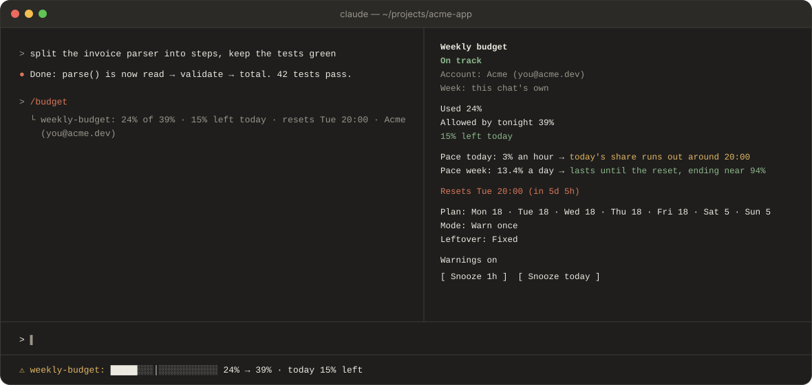
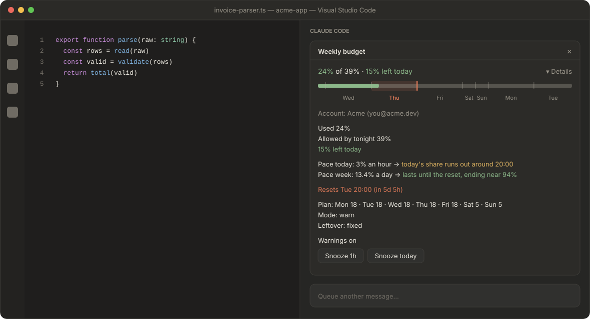
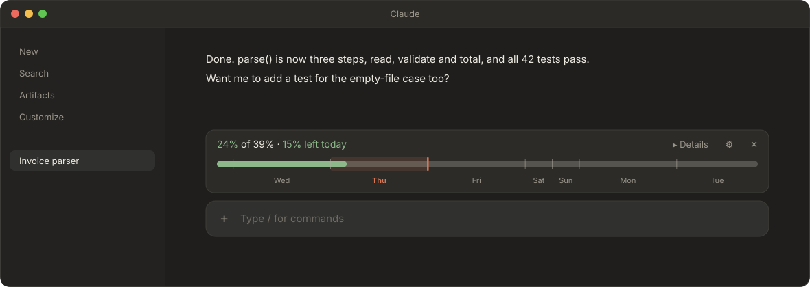
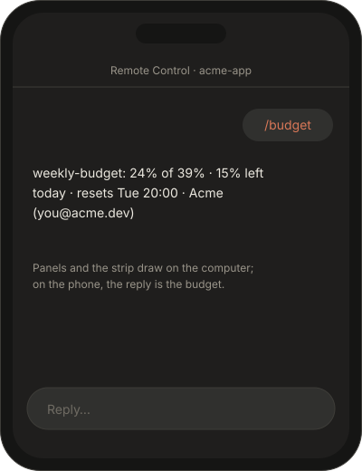
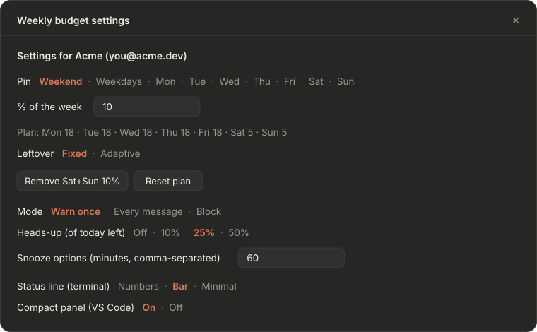

# The apps

weekly-budget draws in each Claude app the way that app allows. The pictures show one made-up week: Thursday 15:00, the weekend pinned at 10%, 24% used.

| | Always visible | `/budget` | `/budget-config` |
| --- | --- | --- | --- |
| **Terminal** | the status line | replies, and opens the details pane | the settings pane, keyboard-driven |
| **VS Code** | one panel above the chat box | replies, and opens the panel (even if you closed it) | the settings pane |
| **Desktop app** | a strip above the message box | replies, and brings the strip back if you hid it | the settings beside the conversation |
| **Phone (Remote Control)** | nothing | replies | opens on the computer |

## Terminal



### The status line

Always under the prompt. Claude Code draws it, puts "⚠ weekly-budget:" in front and picks the colour, so the words and the bar carry the state. Three styles, chosen with **Status line (terminal)**:

| Style | Looks like |
| --- | --- |
| **Numbers** | `Week 24% / 39% allowed · today 15% left` |
| **Bar** (default) | `█████░░░│░░░░░░░░░░░ 24% → 39% · today 15% left` |
| **Minimal** | `15% left today` |

In the bar, █ is what you've used, │ marks what's allowed by tonight, and ▓ is anything used past it, so "over" reads even without colour.

### Panes

`/budget` opens the **details** beside the chat: the state in a coloured word (On track, Running low, Over today), the account, the numbers, the pace, the reset, your plan, the mode and the snooze buttons. `/budget-config` opens the **settings** with the keyboard on them: Tab or the arrows move, Enter chooses, Esc goes back to the prompt, and `ctrl+x tab` comes back to the pane. Nothing opens by itself in the terminal.

## VS Code



One panel, titled "Weekly budget", sits above the chat box and opens by itself when a chat starts.

- **The summary line:** "24% of 39% · 15% left today", with what you used and today's balance coloured by the state (green, amber or red, in Claude's theme).
- **The bar:** the whole week, each day as wide as its share of the plan (an 18% weekday is wide, a 5% weekend day thin), today highlighted in Claude orange, and a marker at what's allowed by tonight. Days too narrow for their name go unlabelled.
- **The details**, under the bar.

**Two views**, set with **Compact panel (VS Code)**:

- **On (default), compact:** the summary and the bar, with a quiet **▸ Details** link that unfolds the details (and reads **▾ Details** while they're open).
- **Off, full:** the details are always shown, with no link.

Changing the view never closes the panel. Close it with its ✕ and it stays closed for that chat, until you run `/budget`. VS Code has no status line for plugins, so the panel is the always-on view there.

## The Claude desktop app



In the desktop app's Code tab (macOS, Windows or the Linux beta), the budget is a thin strip just above the message box: the coloured summary and the week's bar.

- **▸ Details** opens the full details in the panel beside the conversation.
- **⚙** opens the settings there.
- **✕** hides the strip for that chat. A new chat shows it again, and `/budget` brings it back.

No panel opens by itself.

## On your phone



When you drive a computer's session from the Claude mobile app with **Remote Control**, the panels and the strip still draw on the computer, but replies reach the phone. So `/budget` answers in words:

```
24% of 39% · 15% left today · resets Tue 20:00 · Acme (you@acme.dev)
```

## The settings



Every setting is a row of choices, the chosen one in Claude orange; click it in VS Code and the desktop app, or use the keyboard in the terminal. The header says whose settings they are. A value the plan's checks refuse, such as shares adding up to more than 100%, shows in red and changes nothing.

| Setting | Choices | Default | What it does |
| --- | --- | --- | --- |
| **Pin** and **% of the week** | Weekend, Weekdays, or one day; then a percent | no pins | Gives those days that share of the week. See [The plan](the-plan.md). |
| **Remove …** / **Reset plan** | buttons | | Remove one pin, or all of them. |
| **Leftover** | Fixed · Adaptive | Fixed | What happens to what a day doesn't use, or uses past its share. |
| **Mode** | Warn once · Every message · Block | Warn once | How it warns when you're over today's share. See [Warnings](warnings.md). |
| **Heads-up (of today left)** | Off · 10% · 25% · 50% | 25% | An early notification when that much of today's share is left. |
| **Snooze options** | minutes, comma-separated | 60 | The snooze buttons in the details. "Snooze today" is always there too. |
| **Status line (terminal)** | Numbers · Bar · Minimal | Bar | The terminal's line. No effect in VS Code or the desktop app. |
| **Compact panel (VS Code)** | On · Off | On | The VS Code panel's view. |

A change applies at once, in every open chat on that account.

## Where it can't draw

claude.ai, Claude Code on the web and the regular Claude chat run no plugins, so the budget can't show there. Their usage still counts against the same weekly limit, and shows up in Claude Code with the next fresh figure.
